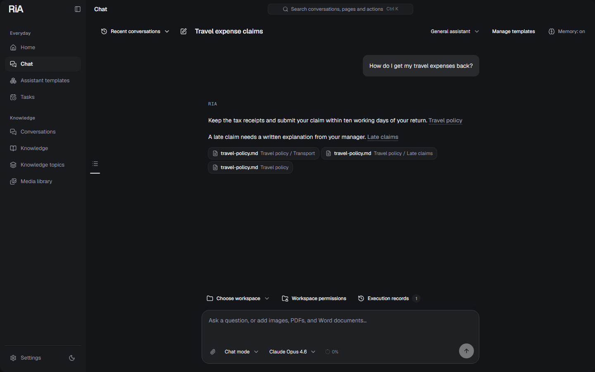
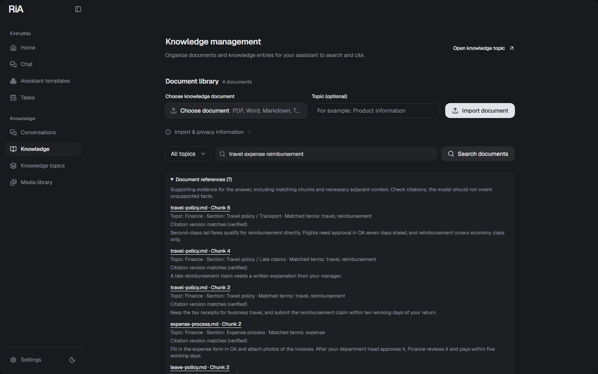
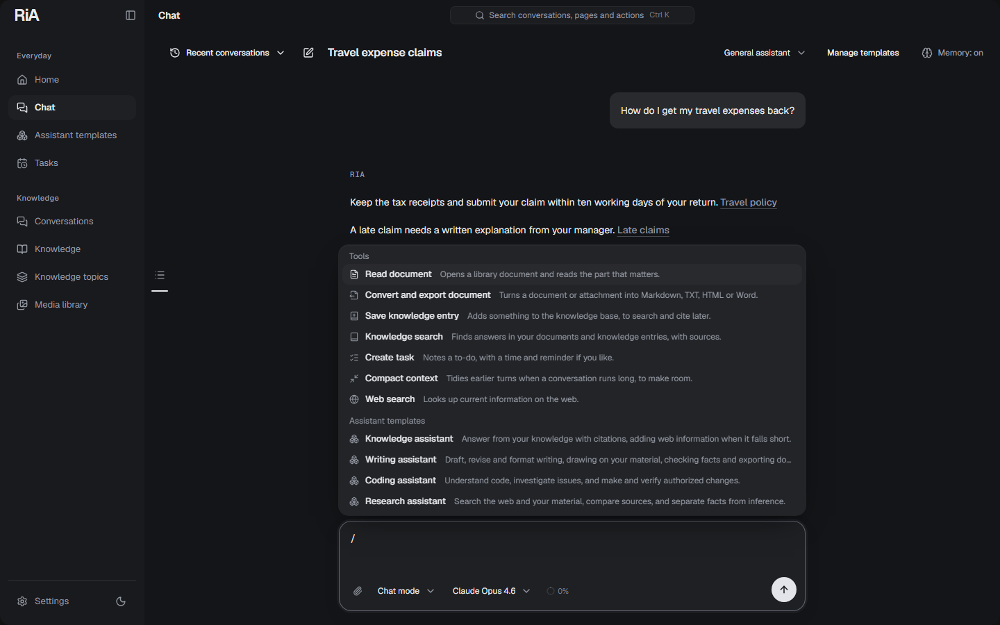
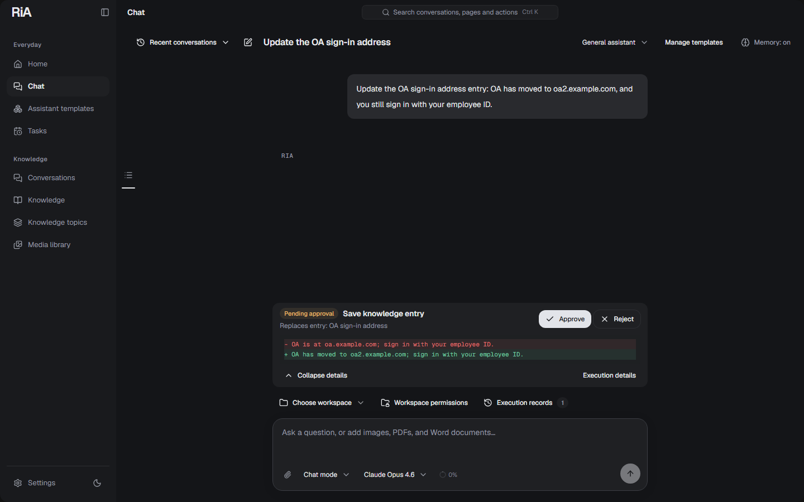
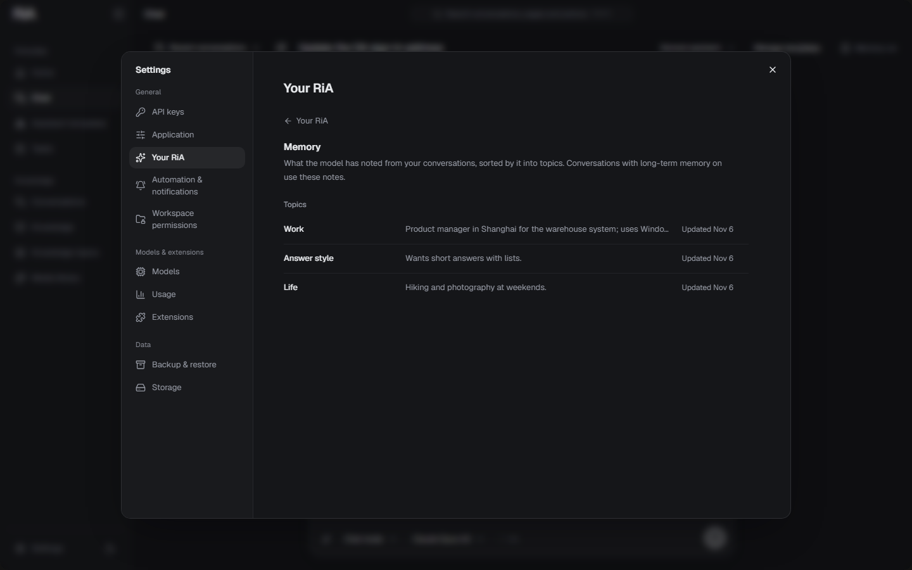
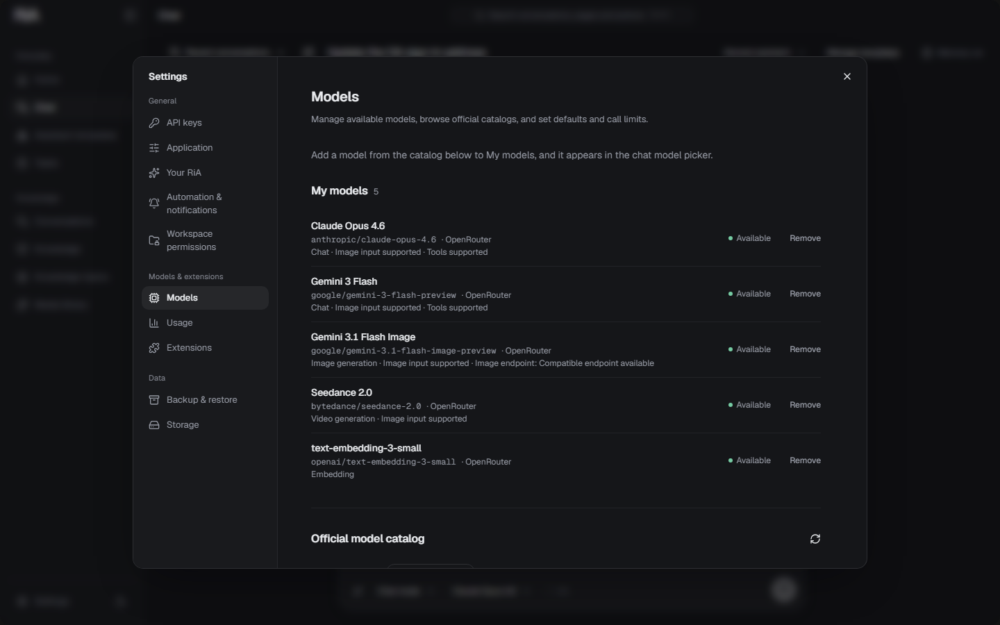
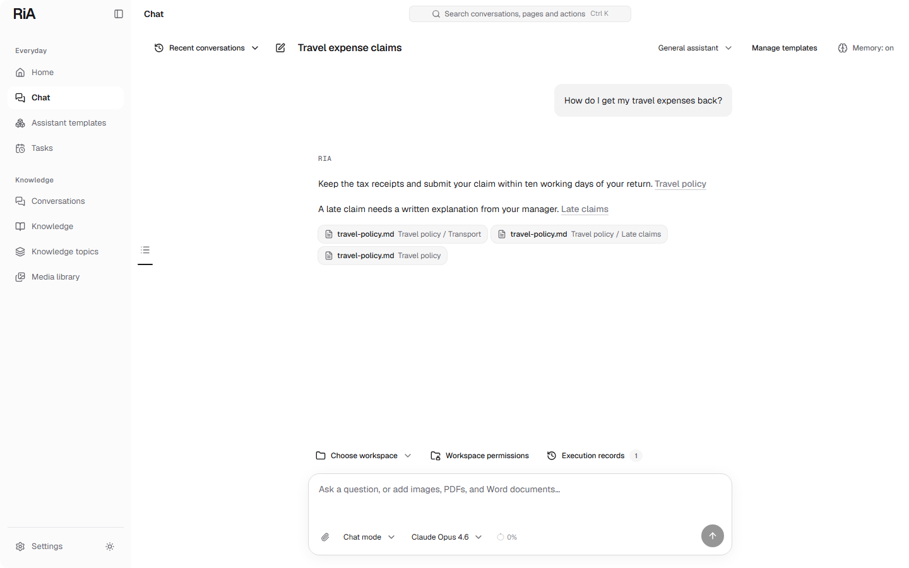

# RiA

**English** · [简体中文](README.zh-CN.md)

**A local-first AI agent for your Windows desktop: it answers from your own documents, uses tools with your approval, and remembers what matters to you.**



RiA keeps your conversations, knowledge base, memory and settings on your computer, in a local SQLite database. You bring the model: connect OpenRouter for hundreds of chat, image, video and embedding models, or DeepSeek directly. Only what an operation needs is sent to the service that performs it.

Current version: **0.1.19** · Windows x64 · Built with Electron, Next.js, the Vercel AI SDK, Prisma and SQLite.

## Ask your own documents



Import PDF, Word, Markdown or text files, check the extracted text, and save them under topics such as Finance or IT. RiA indexes them in the background as soon as an embedding model is chosen; each document simply shows **Ready**, **Processing** or **Pending**.

Search combines keyword matching (BM25) with search by meaning, so a question in your own words still finds the paragraph that uses different ones. In chat the model searches when a question depends on your material and cites the exact passage, with a link back to the version it read. Knowledge entries hold short facts you want kept, such as an address, a code or a definition. [Knowledge library](docs/document-knowledge.md)

## Tools, one keystroke away



Type `/` in the message box to pick a tool, a Skill or an assistant template. Only what you can actually use is listed; the model can also choose tools on its own. Built in: knowledge search, document reading and conversion to Markdown, TXT, HTML or Word, web search through your chat model's provider, tasks that run on a schedule, a PowerShell terminal, and file reading and editing in folders you grant. [Tools](docs/tool-readiness.md) · [Assistant templates](docs/assistant-templates.md)

## Nothing happens behind your back



Actions with consequences wait for you. Each terminal command, file edit, external tool call and knowledge-base change shows exactly what will happen before you approve or reject it: the command, the diff, or the entry text being replaced. **Execution records** keep every step, tool input and output, source and failure for each request. Folder access is granted per folder, and the terminal is enabled separately. [Execution records](docs/execution-history.md) · [Terminal](docs/terminal-tools.md)

## It remembers what matters



With long-term memory on, the model notes durable things about you, such as your role, how you like answers and the projects you work on, in a plain **MEMORY.md**. It judges carefully: most turns write nothing, and it never writes when you tell it not to. The notes are sorted into topics you can browse, edit and delete under **Settings → Your RiA**. Long conversations stay usable: as the context fills up, older turns are summarized while the model can still look up the original messages. [Long-term memory](docs/long-term-memory.md) · [Context management](docs/context-management.md)

## Your models, your keys



Add the models you want from the live OpenRouter catalog or DeepSeek, choose defaults for chat, images, video and embeddings, and pick an optional auxiliary model for background work such as summaries. Context window, tool support and pricing come from the provider. Usage is recorded per request, and the usage ring in the message box shows what the context currently holds. A model that cannot call tools still chats; RiA asks you to confirm first and explains which features it can't use. API keys are kept in the system-encrypted store. [Models and usage](docs/model-usage.md)

## Extend it

- **Community Skills** from skills.sh: instructions and reference files the model reads when they are relevant.
- **MCP servers and HTTP APIs**: discover servers in the official MCP Registry or connect Streamable HTTP, local stdio MCP or plain HTTP tools yourself. Every external call needs your approval.
- **RiA plugin packages** (`.ria-plugin.json`) combine Skills with connections and install in one step.

Installing a Skill never runs its scripts or grants file access. [Plugins](docs/plugin-packages.md) · [Connections](docs/extensions.md)

## More in the box

| | |
| --- | --- |
| Chat | Streaming answers, reasoning shown while the model thinks and folded when it answers, image/PDF/Word attachments, message times, search, tags, archive and export. [Conversations](docs/conversation-management.md) |
| Media | Image and video generation through supported OpenRouter models, kept in a private media library. [Media library](docs/media-library.md) |
| Tasks | Have RiA do something by itself, once or on a schedule, each task in its own conversation, with a notification when it is done. [Tasks](docs/tasks.md) |
| Desktop | Tray, global hotkey, command palette (**Ctrl+K**), light and dark themes, Chinese and English interface. [Desktop](docs/desktop.md) |
| Your data | Backup and restore, storage cleanup, backups as a scheduled task, and workspace reviews. [Backups](docs/workspace-backups.md) · [Storage](docs/media-storage.md) |



<sub>Screenshots are of RiA 0.1.18 running with demo documents and a test model.</sub>

## Get started

1. Install `RiA-<version>-x64.msi`, built as described in [Build an installer](#build-an-installer). No separate Node.js or database server is needed.
2. Open **Settings → API keys** and add an OpenRouter or DeepSeek key. OpenRouter is needed for images, video and embeddings.
3. In **Settings → Models**, add models to **My models** and choose a default chat model. Pick one that supports tool calling to use tools, Skills and knowledge search, and choose an embedding model to search by meaning.
4. Start chatting. Import documents under **Knowledge**, type `/` for tools, and grant folders through **Workspace permissions** when you want RiA to work with files.

History, local keyword search and scheduled backups work without a model service. Tasks run while RiA is open, including in the tray.

## Privacy

Everything RiA stores is local: by default under `%APPDATA%\RiA`. A model, embedding, search or connector request sends only what that operation needs to the service you configured; choosing an embedding model is the consent to send your knowledge base's text to it. Portable backups exclude API keys and the local access credential. Local API requests are checked for the access credential, Host and Origin, size limits and rate limits. [API security](docs/api-security.md) · [Backups](docs/workspace-backups.md)

## Development

Development and CI use Node.js **24.9.0** and npm **11.19.1** on Windows x64.

```powershell
npx --yes npm@11.19.1 ci
npm run db:generate
npm run desktop:dev
```

Electron starts and stops the local Next.js service as a child process; configure keys in the desktop Settings. `npm run dev` runs a browser-based development loop on `.desktop-data/dev/app.db`; the delivered application is the desktop build. After dependency changes, run `npx --yes npm@11.19.1 audit --audit-level=low`. See [project structure](docs/project-structure.md), [local API contracts](docs/local-api.md) and [model catalog maintenance](docs/model-catalog.md).

### Build an installer

```powershell
npm run desktop:make
```

This builds the desktop runtime and packages a versioned MSI with SHA-256 verification metadata in `out/make/wix/x64/`. Run `npm run desktop:version` once before building a new version; builds do not change the version on their own.

| Command | Output |
| --- | --- |
| `npm run desktop:build` | Verified standalone runtime in `.desktop-runtime/` |
| `npm run desktop:package` | Unpacked application in `out/RiA-win32-x64/` |
| `npm run desktop:make` | MSI and verification metadata in `out/make/wix/x64/` |

The installer lets you choose the program directory; workspace data stays under `%APPDATA%\RiA`. A manually started release workflow builds a draft GitHub release with a signed update manifest, and installed copies offer published releases in Settings. Windows code signing is not configured. See [desktop development and release](docs/desktop.md) and [Windows release acceptance](docs/windows-release-acceptance.md).

### Validation

`npm test` runs the type, lint, schema, server, desktop, diagnostic and browser checks. Individually:

```powershell
npm run lint
npm run typecheck
npm run test:server
npm run test:db
npm run test:desktop
npm run test:e2e
npm run test:desktop:smoke
```

Tests use isolated SQLite databases and deterministic fixtures for external services. They check application behavior; they do not measure live model quality or replace installation and upgrade acceptance on a clean Windows machine. See [testing](docs/testing.md) and [CI validation](docs/ci-validation.md).

### Upgrading older workspaces

Older account-based databases are inventoried and snapshotted before becoming a local workspace, and data from several accounts needs an explicit ownership decision rather than a silent merge. Use `npm run workspace:status`, `workspace:inventory`, `workspace:prepare` and `workspace:restore`; see [workspace upgrade and recovery](docs/workspace-upgrade.md).

### Project layout

| Path | Responsibility |
| --- | --- |
| `electron/` | Main process, preload bridge, settings, migrations and desktop security |
| `src/app/` | Pages and local API route handlers |
| `src/features/` | Interface by area: chat, knowledge, models, assistants, settings |
| `src/lib/chat/` | Requests, context, compaction, streaming and persistence |
| `src/lib/documents/` | Extraction, chunking, indexing and hybrid retrieval |
| `src/lib/knowledge/` | Knowledge entries and their search |
| `src/lib/memory/` | Long-term memory (MEMORY.md) and its topics |
| `src/tools/` | Tool registry, descriptors and execution |
| `src/lib/plugins/`, `src/lib/extensions/` | Plugin packages, Skills, MCP/HTTP connections and Registry discovery |
| `src/db/` | Prisma schema and SQLite migrations |
| `scripts/` | Development, migration, packaging and validation utilities |
| `tests/` | Server, browser and desktop regression tests |

## License

[MIT](LICENSE)
