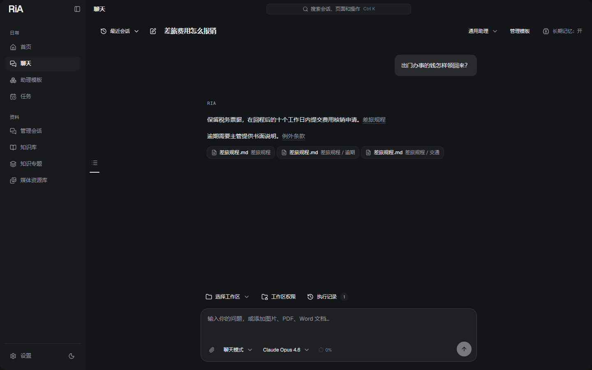
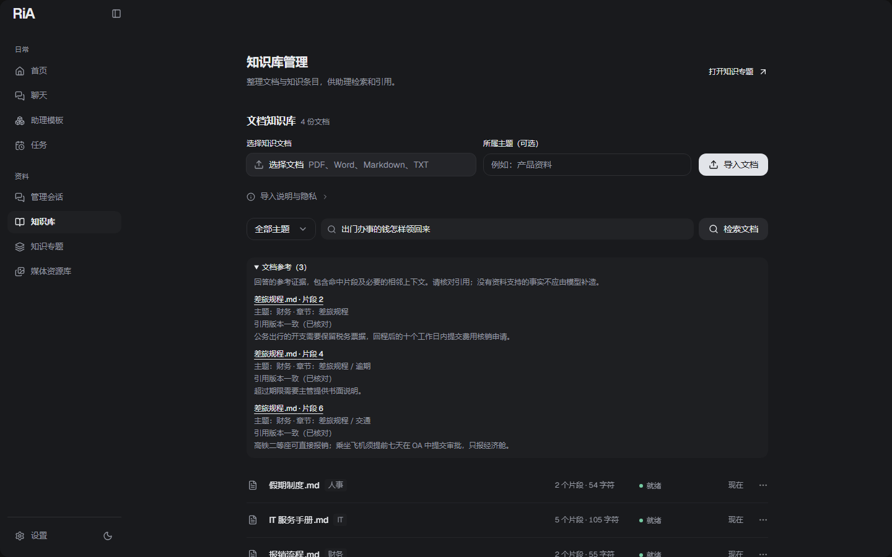
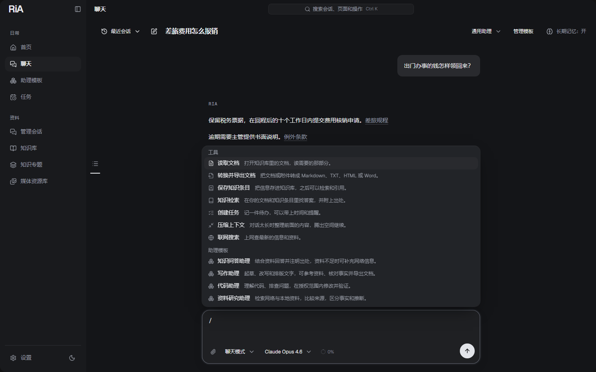
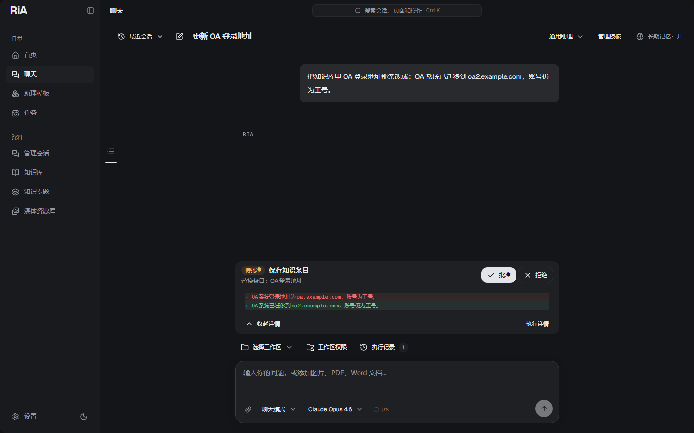
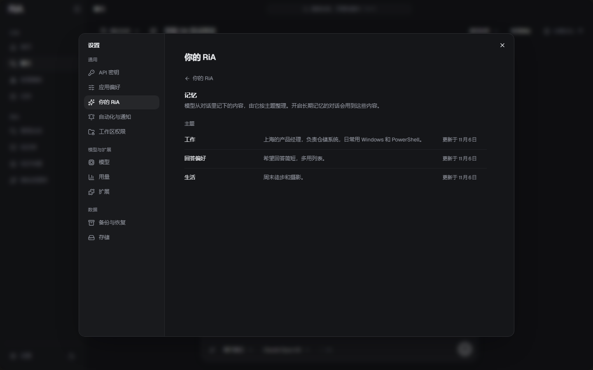
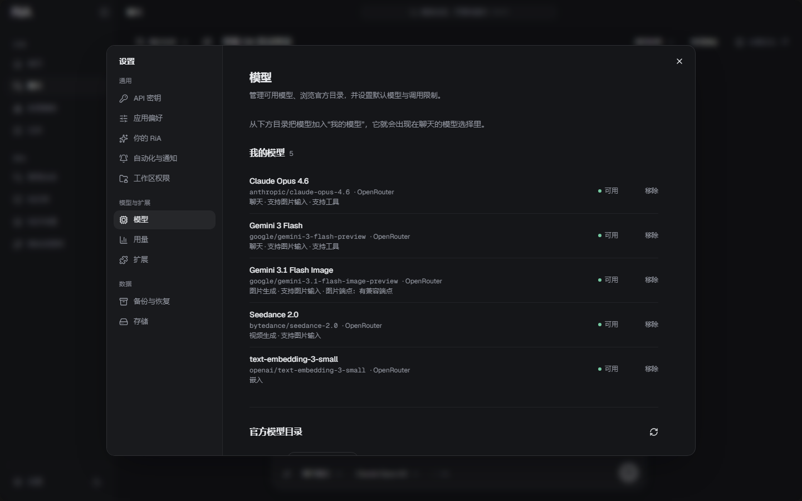
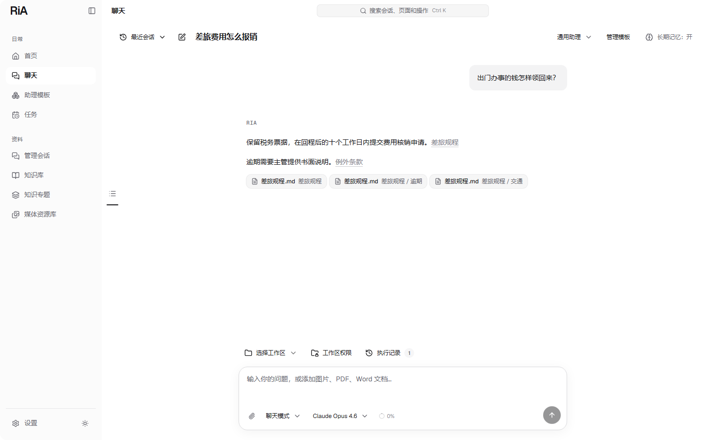

# RiA

[English](README.md) · **简体中文**

**运行在 Windows 桌面上的本地优先 AI 助理：能从你自己的资料里找答案，在你批准后使用工具，还会记住对你重要的事。**



对话、知识库、记忆和设置都存在你自己电脑上的 SQLite 数据库里。模型由你自己选：接入 OpenRouter 可以使用数百种对话、图片、视频和嵌入模型，也可以直连 DeepSeek。每次操作只会把这次需要的内容发给对应的服务。

当前版本：**0.1.18** · Windows x64 · 基于 Electron、Next.js、Vercel AI SDK、Prisma 和 SQLite。

## 从你的资料里找答案



导入 PDF、Word、Markdown 或文本文件，确认提取出的文字，再按“财务”“IT”这样的主题保存。选好嵌入模型后，RiA 会在后台自动建立索引，每份文档只显示**就绪**、**处理中**或**待处理**。

检索同时用关键词（BM25）和语义：换个说法提问，也能找到用词不同的那段原文。在对话里，问题涉及你的资料时，模型会自己去搜，并引用具体段落，链接指向它读到的那个版本。知识条目用来存地址、编号、定义这类简短事实。[知识库](docs/document-knowledge.md) · [知识专题](docs/knowledge-topics.md)

## 输入 / 就能用工具



在输入框里打 `/`，就能选工具、Skill 或助理模板，菜单里只列出你实际能用的。模型也可以自己决定用哪个工具。内置工具包括：知识检索、读取文档并转换为 Markdown、TXT、HTML 或 Word、通过对话模型的服务商联网搜索、按计划自动运行的任务、PowerShell 终端，以及在你授权的文件夹里读取和修改文件。[工具](docs/tool-readiness.md) · [助理模板](docs/assistant-templates.md)

## 每一步都经过你同意



会产生后果的操作都要等你确认。终端命令、文件修改、外部工具调用和知识库改动，在你批准或拒绝之前，都会先把要发生的事完整列出来：要执行的命令、文件改动对比，或者将被替换的条目原文。**执行记录**保存每次请求的每一步、工具的输入输出、来源和失败原因。文件夹按个授权，终端要单独开启。[执行记录](docs/execution-history.md) · [终端](docs/terminal-tools.md)

## 记得对你重要的事



打开长期记忆后，模型会把关于你的长期信息记进一份 **MEMORY.md**，比如你的职业、喜欢的回答方式、在做的项目。它的判断很克制：大多数对话一条都不记，你说了不要记，它就不会记。这些内容按主题整理，可以在**设置 → 你的 RiA** 里查看、修改和删除。长对话也能一直用下去：上下文快满时，较早的对话会被压缩成摘要，模型需要时仍能查到原文。[长期记忆](docs/long-term-memory.md) · [上下文管理](docs/context-management.md)

## 模型和密钥都是你的



从 OpenRouter 的实时模型目录或 DeepSeek 里挑选模型加入“我的模型”，分别设置对话、图片、视频和嵌入的默认模型；还可以选一个辅助模型，专门处理摘要这类后台工作。上下文长度、是否支持工具和价格都以服务商提供的为准。每次请求的用量都有记录，输入框旁的用量圆环会显示当前上下文的构成。不支持工具调用的模型也能对话，只是开始前 RiA 会请你确认，并说明哪些功能用不了。API 密钥存放在系统加密存储里。[模型与用量](docs/model-usage.md)

## 扩展

- **社区 Skill**（来自 skills.sh）：一组说明和参考文件，相关时由模型按需读取。
- **MCP 服务和 HTTP 接口**：可以在官方 MCP Registry 里发现服务，也可以自己接入 Streamable HTTP、本地 stdio MCP 或普通 HTTP 工具。每次外部调用都需要你批准。
- **RiA 插件包**（`.ria-plugin.json`）：把 Skill 和连接打包在一起，一步安装。

安装 Skill 不会运行其中的脚本，也不会授予文件权限。[插件](docs/plugin-packages.md) · [连接](docs/extensions.md)

## 还有这些

| | |
| --- | --- |
| 对话 | 流式回答；思考过程在模型思考时展开、开始回答时收起；可附图片、PDF 和 Word；显示消息时间；支持搜索、标签、归档和导出。[会话](docs/conversation-management.md) |
| 知识专题 | 围绕选定的资料集合，生成报告、计划或总结，并保存依据。[专题](docs/knowledge-topics.md) |
| 媒体 | 通过支持的 OpenRouter 模型生成图片和视频，保存在本地私有媒体库。[媒体库](docs/media-library.md) |
| 任务 | 让 RiA 在你定的时间自己去做一件事，可以只做一次，也可以按计划重复；每个任务有自己的对话，完成后通知你。[任务](docs/tasks.md) |
| 桌面 | 托盘、全局快捷键、命令面板（**Ctrl+K**）、浅色和深色主题、中英文界面。[桌面](docs/desktop.md) |
| 你的数据 | 备份与恢复、存储清理、定时备份任务和工作区回顾。[备份](docs/workspace-backups.md) · [存储](docs/media-storage.md) |



<sub>截图来自运行中的 RiA 0.1.18，使用的是演示文档和测试模型。</sub>

## 开始使用

1. 安装 `RiA-<version>-x64.msi`，构建方法见[构建安装包](#构建安装包)。不需要另外安装 Node.js 或数据库。
2. 打开**设置 → API 密钥**，填入 OpenRouter 或 DeepSeek 的密钥。图片、视频和嵌入需要 OpenRouter。
3. 在**设置 → 模型**里把模型加入“我的模型”，并选一个默认对话模型。要使用工具、Skill 和知识检索，请选支持工具调用的模型；要按语义检索，再选一个嵌入模型。
4. 开始对话。在**知识库**导入文档，输入 `/` 调用工具；需要处理文件时，在**工作区权限**里授权文件夹。

不配置任何模型服务，也可以查看历史、做本地关键词检索和定时备份。任务在 RiA 运行时执行，最小化到托盘也可以。

## 隐私

RiA 保存的所有内容都在本地，默认位于 `%APPDATA%\RiA`。模型、嵌入、搜索或连接请求只把这次操作需要的内容发给你配置的服务；选择嵌入模型，就表示同意把知识库文字发给该模型。便携备份不包含 API 密钥和本地访问凭据。本地接口会校验访问凭据、Host 和 Origin，并限制请求大小和频率。[接口安全](docs/api-security.md) · [备份](docs/workspace-backups.md)

## 开发

开发和 CI 使用 Windows x64、Node.js **24.9.0** 和 npm **11.19.1**。

```powershell
npx --yes npm@11.19.1 ci
npm run db:generate
npm run desktop:dev
```

Electron 会以子进程方式启动和停止本地 Next.js 服务，密钥在桌面版的设置里配置。`npm run dev` 是基于浏览器的开发模式，数据在 `.desktop-data/dev/app.db`；正式交付的是桌面版。修改依赖后请运行 `npx --yes npm@11.19.1 audit --audit-level=low`。另见[项目结构](docs/project-structure.md)、[本地接口](docs/local-api.md)和[模型目录维护](docs/model-catalog.md)。

### 构建安装包

```powershell
npm run desktop:make
```

这条命令会构建桌面运行时，并在 `out/make/wix/x64/` 生成带版本号的 MSI 和 SHA-256 校验信息。发布新版本前先运行一次 `npm run desktop:version`；构建本身不会改版本号。

| 命令 | 产物 |
| --- | --- |
| `npm run desktop:build` | 经过校验的独立运行时，位于 `.desktop-runtime/` |
| `npm run desktop:package` | 未打包的应用，位于 `out/RiA-win32-x64/` |
| `npm run desktop:make` | MSI 和校验信息，位于 `out/make/wix/x64/` |

安装时可以选择程序目录，工作区数据始终在 `%APPDATA%\RiA`。手动触发的发布流程会生成带签名更新清单的 GitHub 草稿版本，已安装的 RiA 可以在设置里查看并安装已发布的版本。目前没有配置 Windows 代码签名。另见[桌面开发与发布](docs/desktop.md)和 [Windows 发布验收](docs/windows-release-acceptance.md)。

### 验证

`npm test` 会依次运行类型、Lint、数据库结构、服务端、桌面端、诊断和浏览器测试。也可以单独运行：

```powershell
npm run lint
npm run typecheck
npm run test:server
npm run test:db
npm run test:desktop
npm run test:e2e
npm run test:desktop:smoke
```

测试使用隔离的 SQLite 数据库，外部服务都用固定的模拟数据代替。这些测试检查的是应用行为，不能说明真实模型的回答质量，也不能代替在干净 Windows 上的安装和升级验收。另见[测试](docs/testing.md)和 [CI 验证](docs/ci-validation.md)。

### 升级旧工作区

旧版按账户存储的数据库，会先盘点并做快照，再转为本地工作区；数据分散在多个账户时，需要你明确决定归属，不会自动合并。可以使用 `npm run workspace:status`、`workspace:inventory`、`workspace:prepare` 和 `workspace:restore`，详见[工作区升级与恢复](docs/workspace-upgrade.md)。

### 项目结构

| 路径 | 职责 |
| --- | --- |
| `electron/` | 主进程、预加载桥接、设置、迁移和桌面安全 |
| `src/app/` | 页面和本地接口路由 |
| `src/features/` | 按功能划分的界面：对话、知识库、模型、助理、设置等 |
| `src/lib/chat/` | 请求、上下文、压缩、流式输出和持久化 |
| `src/lib/documents/` | 文档提取、分块、索引和混合检索 |
| `src/lib/knowledge/` | 知识条目及其检索 |
| `src/lib/memory/` | 长期记忆（MEMORY.md）及其主题 |
| `src/tools/` | 工具注册、描述和执行 |
| `src/lib/plugins/`、`src/lib/extensions/` | 插件包、Skill、MCP/HTTP 连接和 Registry 发现 |
| `src/db/` | Prisma 结构和 SQLite 迁移 |
| `scripts/` | 开发、迁移、打包和验证脚本 |
| `tests/` | 服务端、浏览器和桌面端回归测试 |

## 许可证

[MIT](LICENSE)
